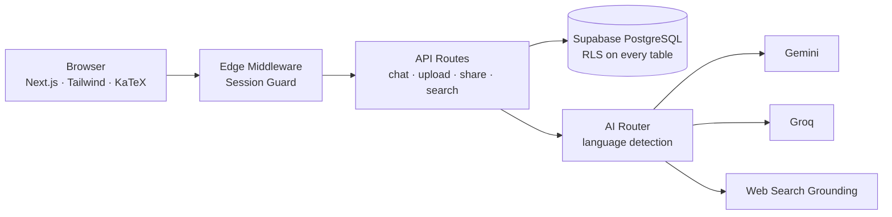

<div align="center">

# 🪔 Pragya AI · प्रज्ञा

### *Ancient Indian Wisdom, Answered by Modern AI*

**A multilingual AI workspace that bridges the Indian Knowledge Systems (IKS) with modern science —**
**ask in English, Hindi (हिन्दी) or Hinglish, and learn from four specialised knowledge personas.**

<br/>

[](https://pragyaai.yashx.xyz)
[](https://nextjs.org/)
[](https://www.typescriptlang.org/)
[](https://supabase.com/)
[](LICENSE)

<br/>

[🚀 Try the Live App](https://pragyaai.yashx.xyz) · [🏛️ Meet the Personas](#️-the-four-knowledge-personas) · [✨ Features](#-features) · [⚡ Quick Start](#-quick-start) · [🛡️ Security](#️-security--privacy)

</div>

---

## 🌏 Why Pragya AI?

For millennia, India cultivated rigorous systems of knowledge — Kanada's atomic theory, Aryabhata's astronomy, Kautilya's statecraft, Bharati Krishna Tirtha's mathematical sutras. Most AI tools flatten all of this into generic answers. **Pragya AI is built differently:**

- 📜 **Rooted, not generic** — answers draw on classical texts *and* verified modern science, and clearly separate the two.
- 🗣️ **Truly multilingual** — the AI detects whether you wrote in English, Hindi or Hinglish, and replies in the same language and script.
- 🎓 **Exhibition-validated** — presented at a university IKS exhibition, where it helped a pharmacy student research her own Ayurveda-based project better than generic AI tools could.

---

## 🏛️ The Four Knowledge Personas

| Persona | Domain | Ask about… | Powered by |
| :--- | :--- | :--- | :--- |
| 🔭 **Pragya Veda** *(प्रज्ञा वेद)* | Physics, Astronomy, Natural Sciences & Ancient Scientific Thought | Nasadiya Sukta vs the Big Bang, Vaisheshika atomism, Surya Siddhanta | Gemini |
| ♟️ **Pragya Neeti** *(प्रज्ञा नीति)* | Corporate Management, Entrepreneurship, Decision-Making & Ethics | Arthashastra's Saptanga for team leaders, strategy, governance | Gemini |
| 🧮 **Pragya Ganita** *(प्रज्ञा गणित)* | Algorithms, Vedic Maths, Number Systems & Computational Logic | Nikhilam sutra multiplications, proofs, Big-O analysis | Groq |
| 🧘 **Pragya Sarathi** *(प्रज्ञा सारथि)* | Mindfulness, Emotional Balance, CBT Concepts & Personal Growth | Exam stress, Yoga Sutras, Gita's Sthitaprajna | Gemini |

> [!IMPORTANT]
> **Safety boundary:** Pragya Sarathi is an educational, reflective mentor — not a therapist. On detecting acute distress, it surfaces national 24×7 helplines (Tele-MANAS `14416`, KIRAN `1800-599-0019`).

---

## ✨ Features

| | |
| :--- | :--- |
| 💬 **Chat Experience** | Streaming answers with a traditional *Kalam* (reed-pen) writing animation, live pipeline status (*Searching sources → Reading → Writing*), one-click starter prompts, retry, and copy-response / copy-LaTeX controls |
| 🔤 **Language Intelligence** | Automatic English / Hindi / Hinglish detection on every message; Sanskrit verses preserved in Devanagari with translations |
| 📐 **Math Engine** | Full LaTeX rendering via KaTeX — inline `$…$` and display `$$…$$` — including boxed, multi-line Vedic maths derivations |
| 📎 **Document Chat** | Attach PDF, DOCX, TXT or images (up to 10 MB); text is extracted server-side and grounded into the conversation |
| 🗂️ **Workspace** | Auto-titled conversation history (grouped Today / Yesterday), full-text search with message snippets, rename, two-step delete, per-chat public share links with revocation |
| ⚙️ **Personalisation** | Language, Light / Dark / System theme, default persona, and a chat-history saving toggle — all in one Settings panel |
| 🎨 **Manuscript Design** | A warm archival-parchment aesthetic inspired by ancient folios, with a deep nocturnal dark mode |

---

## 🛠️ Tech Stack

| Layer | Technology |
| :--- | :--- |
| **Framework** | Next.js 14 (App Router) · React 18 · TypeScript |
| **Styling** | Tailwind CSS · Lucide icons |
| **Backend & Auth** | Supabase — PostgreSQL, SSR Auth (Email + Google), Row-Level Security |
| **AI Providers** | Google Gemini *(Veda, Neeti, Sarathi)* · Groq *(Ganita)*, routed per persona |
| **Documents & Math** | `pdf-parse` · `mammoth` · KaTeX (`remark-math`, `rehype-katex`) |
| **Grounding** | Optional live web search (Tavily) for source-backed answers |



---

## ⚡ Quick Start

**Prerequisites:** Node.js 18.17+ and a free [Supabase](https://supabase.com) project.

```bash
# 1. Clone & install
git clone https://github.com/pimatrix/pragya-ai.git
cd pragya-ai
npm install

# 2. Configure environment
cp .env.example .env.local   # then fill in your keys (table below)

# 3. Create the database tables
#    Run supabase/migrations/*.sql in order in the Supabase SQL Editor,
#    or simply:  npm run db:migrate   (needs DATABASE_URL)

# 4. Run
npm run dev                  # → http://localhost:3000
```

### 🔑 Environment Variables

| Variable | Where to get it |
| :--- | :--- |
| `NEXT_PUBLIC_SUPABASE_URL` | Supabase → Project Settings → API |
| `NEXT_PUBLIC_SUPABASE_PUBLISHABLE_KEY` *(or `…_ANON_KEY`)* | Supabase → Project Settings → API |
| `GEMINI_API_KEY` | [Google AI Studio](https://aistudio.google.com/apikey) (free) |
| `GROQ_API_KEY` | [Groq Console](https://console.groq.com/keys) (free) |
| `DATABASE_URL` | Supabase → Settings → Database *(migrations only)* |
| `SEARCH_API_KEY` + `SEARCH_PROVIDER=tavily` | [Tavily](https://tavily.com) *(optional)* |

> The app **builds and runs even before keys are configured** (safe placeholder fallbacks) — add real keys for full functionality. Never commit your `.env.local`.

---

## 📁 Project Structure

```
pragya-ai/
├── src/
│   ├── app/            # Routes: login, chat (/c/[id]), share pages, API handlers
│   ├── components/     # ChatDashboard, ChatWorkspace, Sidebar, Modals, MarkdownRenderer
│   └── lib/            # AI router (Gemini/Groq), personas, sources, supabase, rate-limit
├── supabase/
│   └── migrations/     # 5 forward-only SQL migrations (schema, sharing, security fixes)
├── pragya-*-prompt.txt # The four persona system prompts
└── .env.example        # Fully commented environment template
```

---

## 🛡️ Security & Privacy

- 🔐 **Server-side auth on every API route** — unauthenticated requests get `401`, no exceptions.
- 🧱 **Row-Level Security everywhere** — all 7 PostgreSQL tables restrict users strictly to their own data.
- ⏱️ **Rate limiting** — chat (20 req/min) and uploads (10 req/min) per user, protecting AI provider quotas.
- 🎟️ **Unguessable share links** — public links use cryptographic random tokens and can be revoked instantly.
- 🤫 **Zero secret exposure** — no real keys in this repo; `.env.example` carries placeholders only.

---

## ✨ Refined Release — Highlights

Hardened and polished after a full hands-on QA review of the live product:

- Next.js upgraded to the latest patched 14.2.x · per-user API rate limiting added
- Rename, settings-confirmation, sign-out feedback, share-dialog and clipped-header bugs fixed
- Starter prompts now send on click · persona descriptions unified across login and app
- Clean first-run experience: builds succeed even before environment setup

---

<div align="center">

## 📜 License

Open-source under the **MIT License** — see [LICENSE](LICENSE).

*Developed with reverence for the timeless heritage of the Indian Knowledge Systems,*
*and dedication to modern scientific computation.*

**Built by [Yash Sharma](https://github.com/yash-sharmax)** · BTech, Medicaps University

🪔 **[pragyaai.yashx.xyz](https://pragyaai.yashx.xyz)** 🪔

</div>
